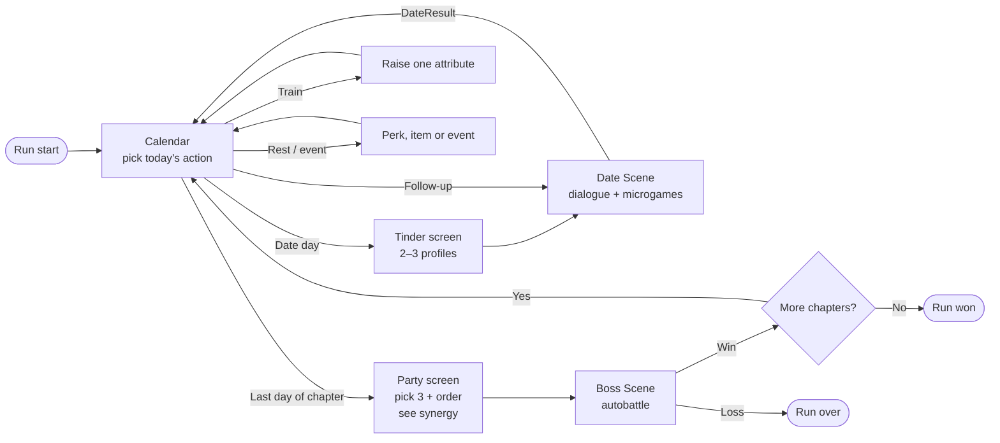

# Core Loop

## Concept

- A **run** is a few **chapters** (one in the first build). Each chapter is a
  short stretch of calendar days, about 5 actions, ending with a
  **life-event boss**.
- Each day you spend one **action**: a first date, a follow-up date, training
  or a rest/event day.
- Dates **recruit** girls into your **party** (cap 6) and **follow-up** dates
  raise their **Affection** (0–3).
- On the chapter's last day you pick **3 girls and their order**, then watch
  them **autobattle** the boss. You never fight.
- Win and you move on to the next chapter. Lose and the run ends. A run is
  about 30 minutes.



---

## How it all comes together

This is the most important section. Each module is small on its own; the
game comes from how they feed each other. Here is a run, step by step, with
what each piece contributes.

### 1. The boss sets the question, from day one

The **Boss Scene** module defines the chapter's life event and its **type**
(Pokémon-style strengths and weaknesses). The **Calendar** shows it from the
chapter's first day. So before you've met anyone you know what you're
building toward: *"Meeting the Parents is weak to Heart girls and strong
against Chaotic ones."* Every later choice is an answer to that question.

### 2. The calendar is the budget

The **Calendar** gives you about 5 actions per chapter, and every action
costs a day. That scarcity is the core tension:

- A **first date** adds a new girl (widens the party).
- A **follow-up** raises one girl's Affection (deepens the party).
- **Training** raises an attribute, which makes future dates safer and
  improves player–girl synergy.
- A **rest/event** day can hand you a perk that changes your whole plan.

You can't do everything, so you're always trading breadth against depth
against long-term power.

### 3. Profiles are the draft

On a date day the **Tinder screen** deals 2–3 random **girls** (from the
**Girl Character** module's `GirlData` pool). Each profile shows her **tags**.
This is the roguelike "draft" moment: do you take the girl who completes your
Artsy set (**Synergy**), the one strong against the boss type (**Boss**), or
the one whose preferences match your attributes (an easier **Date**)? Some
girls only appear once your attributes or perks pass a threshold, so training
and perks also change what the draft offers.

### 4. The date is the skill test

The **Date Scene** is where you actually play. Your **Player** attributes
decide which dialogue options are safe and which are risky. Your **Perks**
add or remove options and change **microgame** difficulty. The girl's
`GirlData` supplies her lines, preferences and microgames. Doing well turns
into **Affection** (0–3); Affection 1+ means she joins. A failed first date
means she's gone for the run, so risk has a real cost.

### 5. The party is the build

Each recruited girl becomes a `PartyMember` in `RunState`. The **Synergy
System** reads the whole party and works out:

- **Girl–girl synergy**: shared tags hitting thresholds (2 Artsy, then 4).
- **Player–girl synergy**: her Affection, how well your attributes match
  her preferences, and perks that interact with her tags (Inebriated boosts
  Stoner girls).

With a cap of 6, a full party forces a **break-up** to add someone new. That
is where you prune the build.

### 6. Perks bend the rules

**Perks** are Balatro-joker build-arounds. One perk can touch every module:
Sleepy gives you more time in microgames (Date), Inebriated makes risky
options pay more (Date) and boosts Stoner girls (Synergy). Finding a perk
early can redirect the whole run. That's the replay engine.

### 7. The boss is the exam

On the last day you pick **3 of your girls and their order** on the party
screen, which shows the synergy report. Then the **Boss Scene** runs a Super
Auto Pets–style lineup fight with no input. Each girl's strength is:

```
attack = base attack × (1 + 0.25 × Affection) × synergy multiplier
```

(0.25 is a number to tune, not a decision.)

So the fight grades everything you did: who you dated (**Girls/tags**), how
well (**Affection**), how you trained (**Attributes → player–girl synergy**),
which perks you found (**Perks**) and whether you read the boss's type
(**Boss**). Watching it is the payoff. Losing tells you which of those you
got wrong.

### 8. Next chapter, harder question

Win, and the next chapter's boss appears with a different type, and the
party you built has to adapt. Lose, and the run ends; the next run deals
different girls, perks and events.

### The one-line version

> **The boss asks a question → the calendar limits your time → profiles
> offer answers → dates test your skill → the party and perks form your
> build → synergy turns the build into numbers → the boss fight grades it.**

### What crosses between modules

| From → To | What crosses |
|---|---|
| Boss → Calendar | Boss type, shown from day 1 |
| Calendar → Tinder → Date | Today's action; 2–3 `GirlData` offers |
| Player → Date | Attributes (option risk), perks (option and microgame modifiers), inventory (reactions) |
| Girl → Date | Art, dialogue, preferences, microgame pool, item reactions |
| Date → RunState | `DateResult`: girl, Affection, attribute gains, perks earned |
| Calendar → Player | Training gains; event perks and items |
| Party + Player → Synergy | Tags, Affection, preferences vs attributes, perks |
| Synergy → Calendar | Synergy report on the party screen |
| Synergy + Girls + Perks → Boss | Battle stats × multipliers, abilities |
| Boss → Calendar | Win (next chapter) or loss (run ends) |

---

## Systems

Modules are *things you build*. Systems are *what the player experiences*,
and each one spans several modules. The "Systems it's part of" section in
every module file points back here.

| System | What the player experiences | Modules involved |
|---|---|---|
| **Run Loop** | Days pass, chapters end, the run is won or lost | Calendar, Boss, RunState |
| **Relationships** | Meet, recruit, deepen (follow-ups), break up | Girls, Dates, Calendar, RunState |
| **Build** | Shaping a party and perk set toward a plan | Perks, Player, Girls, Synergy |
| **Skill Test** | Moment-to-moment play on a date | Dates (dialogue, microgames), Player, Perks |
| **Combat** | Picking a lineup and watching the fight | Boss, Synergy, Girls |
| **Content Pipeline** | Adding girls, lines, perks, bosses without code | Girls, Dates, Perks, Boss (all data-driven) |

---

## Shared code

Every module builds on this layer. Nothing here is written yet. The
"Replaces" column shows what in today's code it takes over from.

### Shared objects

| Object | Base class | What it holds | Replaces |
|---|---|---|---|
| `RunState` | `Node` (autoload) | The player, party, current day and chapter, perks, inventory, the chapter's schedule, girls seen or gone this run. Scenes read and write it and never call each other directly. | `PlayerManager` (state half) |
| `SceneRouter` | `Node` (autoload) | Scene changes and fade transitions, so `RunState` stays pure data. | `PlayerManager` (scene-change half) |
| `PlayerData` | `Resource` (runtime) | Four attributes (Culture, Intellect, Seduction, Heart, 0–100). | `PlayerCharacter` |
| `GirlData` | `Resource` (`.tres`, one per girl) | Everything about a girl that's the same every run. See [girls.md](girls.md). | `DateCharacter` + `SmokeyCharacter` / `SplitEndsCharacter` |
| `PartyMember` | `Resource` (runtime) | A girl in *this* run: `GirlData` ref, Affection, current HP, buffs. | `party` array of `DateCharacter` nodes |
| `PerkData` | `Resource` (`.tres`) | A perk's name, art and hook functions. See [perks.md](perks.md). | `Perk`, `Inebriated`, `Sleepy` |
| `TagData` | `Resource` (`.tres`) | A tag's name, icon, thresholds and bonus per threshold. | — |
| `BossData` | `Resource` (`.tres`) | Life event, type, stats, abilities, art. | — |
| `ItemData` | `Resource` | Name, art. Flavor only in the first build. | `InventoryItem` + subclasses |
| `DateResult` | `RefCounted` | Girl, Affection, attribute gains, perks earned. | — |
| `SynergyReport` | `RefCounted` | Active tag bonuses and per-girl multipliers. | — |
| `Microgame` | `Control` (base scene) | The contract every microgame scene follows. | — |
| `Attr` | `enum` in a constants script | `CULTURE, INTELLECT, SEDUCTION, HEART`, so attributes aren't loose strings. | string keys like `"Culture"` |

### Shared functions

| Function | Lives on | Used by |
|---|---|---|
| `RunState.start_run(seed)` | RunState | Intro |
| `RunState.apply_date_result(result: DateResult)` | RunState | Dates |
| `RunState.add_party_member(girl: GirlData, affection: int)` | RunState | Dates (via `apply_date_result`) |
| `RunState.break_up(member: PartyMember)` | RunState | Calendar (party screen) |
| `RunState.add_perk(perk: PerkData)` / `add_item(item)` | RunState | Calendar events, Dates |
| `RunState.advance_day()` | RunState | Calendar |
| `RunState.get_attribute(a: Attr)` / `raise_attribute(a, amount)` | RunState | Dates, Calendar (training), Synergy |
| `SceneRouter.go_to(scene_id, payload := {})` | SceneRouter | Every scene |
| `Synergy.calculate(party, player, perks) -> SynergyReport` | static on `Synergy` | Calendar (party screen), Boss |
| `PerkData` hooks: `modify_options`, `modify_microgame`, `modify_score`, `modify_synergy`, `modify_battle` (TBD) | each perk | Dates, Synergy, Boss |
| `Microgame.start(difficulty, modifiers)` → `finished(success)` signal | each microgame | Dates |

### Signals on `RunState`

`day_changed(day)`, `party_changed()`, `perks_changed()`,
`attributes_changed()`, `run_ended(won: bool)`. UI listens to these instead
of being told to refresh by other scenes.

### Build order

1. Shared data model (`RunState`, `GirlData`, `PartyMember`, `PerkData`, `TagData`)
2. Synergy + Boss test scene, with hand-made parties of the 3 test girls
3. Dates (one score, dialogue via Dialogue Manager, 3 microgames)
4. Calendar (generated schedule, Tinder screen, party screen)
5. Wire the full run together
